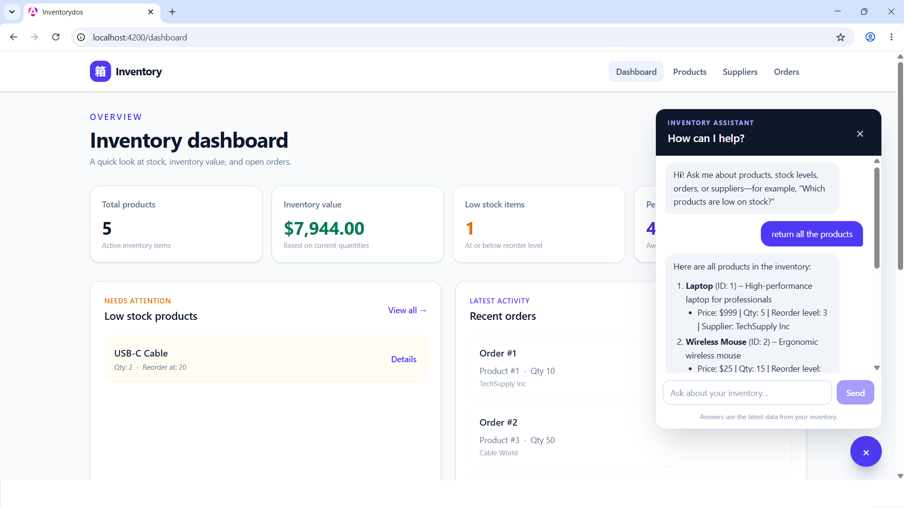
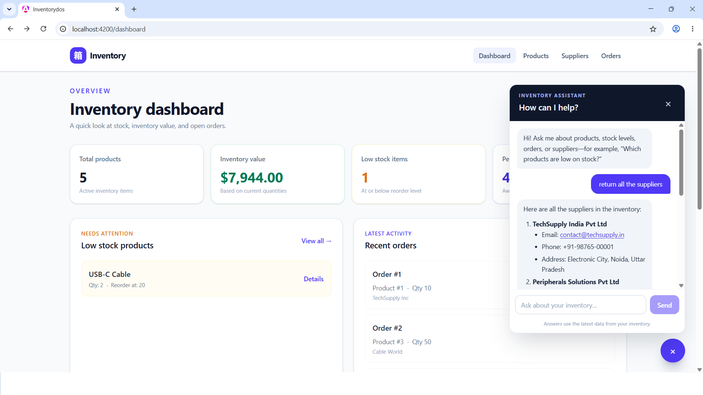

# Inventory Management System

An Angular inventory management app with product, supplier, and order pages, plus an OpenRouter-powered chatbot available throughout the app. The chatbot uses LangChain.js on a Node.js API and answers questions using the latest data from the inventory API.

## Requirements

- Node.js `^20.19.0`, `^22.12.0`, or `>=24.0.0` and npm
- An OpenRouter API key

## Install

From the project root, install the dependencies:

```powershell
npm install
```

Create a `.env` file in the project root (or edit the `.env` you already created) and add your OpenRouter API key:

```env
OPENROUTER_API_KEY=your_openrouter_api_key

# Optional overrides
# OPENROUTER_MODEL=nvidia/nemotron-3-ultra-550b-a55b:free
# CHAT_API_PORT=3001
# INVENTORY_API_URL=http://localhost:3000
```

Keep the API key private. `.env` is ignored by git.

The chatbot uses OpenRouter's `https://openrouter.ai/api/v1` endpoint and defaults to the `nvidia/nemotron-3-ultra-550b-a55b:free` model. Set `OPENROUTER_MODEL` to use another model available through OpenRouter. The inventory API URL defaults to `http://localhost:3000`; the chatbot API port defaults to `3001`. If you change `CHAT_API_PORT`, update the endpoint in `src/app/services/chat.service.ts` to match.

## Run locally

Start each service in a separate terminal from the project root:

```powershell
npm run json-server
```

```powershell
npm run chat-api
```

```powershell
npm start
```

The inventory API runs at `http://localhost:3000`, the chatbot API at `http://localhost:3001`, and Angular is usually available at `http://localhost:4200`. Open the Angular app and use the **Ask inventory** button on any route to ask about products, stock, orders, or suppliers.

The chatbot API fetches current products, suppliers, and orders from JSON Server for each question. Both the inventory API and chatbot API must be running for chatbot responses.

## Available commands

| Command | Description |
| --- | --- |
| `npm start` | Start the Angular development server |
| `npm run json-server` | Start the mock inventory API using `db.json` |
| `npm run chat-api` | Start the LangChain/OpenRouter chatbot API |
| `npm run build` | Create a production Angular build |
| `npm test` | Run Angular unit tests |

## Features

- Dashboard with inventory metrics and recent orders
- Product listing and product detail pages
- Supplier directory and order tracking
- Chat assistant available on every route, using current inventory data
- Responsive layout styled with Tailwind CSS v4 utility classes

## Project structure

```text
src/app/components/   Angular pages and chatbot UI
src/app/services/     Inventory and chatbot API clients
src/app/models/       Product, supplier, and order models
.postcssrc.json       Tailwind CSS PostCSS integration
server.mjs            LangChain and OpenRouter chatbot API
db.json               Mock inventory data for JSON Server
```

## Chatbot


